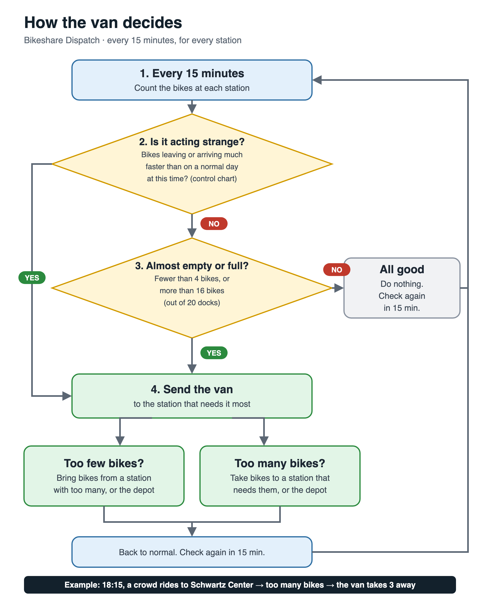

# 🚲 Bikeshare Dispatch: where to send the van (Battery Ninjas)

> ## ▶ Open the tool
>
> **Live link:** not online yet. Deploying to the course Posit Connect server is task H-06; the
> link goes here once it is up. Until then, run the tool on your own computer in three steps.
>
> **1. Install** [Python 3.11+](https://www.python.org/downloads/) and [Node.js 20+](https://nodejs.org/) (once).
>
> **2. In a terminal**, download the repo and start the tool:
>
> ```bash
> git clone https://github.com/hn359/six-sigma-hackathon.git
> cd six-sigma-hackathon
> ./demo.sh
> ```
>
> The first run installs packages and builds the map (a minute or two). Wait for
> `Starting: open http://localhost:8000`.
>
> **3. Open [http://localhost:8000](http://localhost:8000) in your browser.** Keep the terminal open
> while you use it; press **Ctrl+C** there to stop. Next time, just `cd six-sigma-hackathon` and
> `./demo.sh` again.
>
> | Address | What opens |
> |---|---|
> | [localhost:8000](http://localhost:8000) | **the tool**: home page with the four tabs below |
> | [localhost:8000/index.html](http://localhost:8000/index.html) | the dispatch map on its own |
> | [localhost:8000/bikeflow/](http://localhost:8000/bikeflow/) | the BikeFlow charts on their own |
> | [localhost:8000/docs](http://localhost:8000/docs) | the API, with a "Try it out" button on every route |
>
> **If it doesn't start:** "address already in use" means something else is on port 8000; run
> `PORT=8001 ./demo.sh` and open `localhost:8001`. On Windows, run `./demo.sh` from Git Bash. The
> map needs internet for its street tiles.
>
> **What you'll see:** four tabs.
> - **About:** what the tool does, how a dispatcher uses it, and the statistics.
> - **Map and dispatch:** press **Play** or drag the time bar. It is the only control, and the other tabs follow it.
>   Try **Event day** at 18:15 for a planted crowd at Schwartz Center.
> - **Redistribution:** which bikes the van should move now.
> - **SPC charts:** each station's day and its I-MR control chart.
>
> Windows: run `./demo.sh` from Git Bash. To run the tests instead: `./app/testme.sh`.

**Prompt 1, Urban Systems: "Bikeshare Fleets".** Stations run empty or full at rush hour and
rebalancing vans are sent blindly. This tool watches every station at every reading with a
**control chart**. It sends the van only when a station behaves unusually or leaves its spec limits,
and it proves with a **p-chart** whether that policy cut empty/full time.

- **User:** the dispatcher who runs one rebalancing van and a reserve depot of spare bikes.
- **Decisions it supports:**
  - *every reading:* does the van go anywhere, where, and how many bikes;
  - *every night:* how many bikes each station starts with tomorrow;
  - *every week:* did the policy work?
- **Stack:**
  - Python **FastAPI** back end;
  - statistics in [`app/qc.py`](app/qc.py);
  - **React + Leaflet** map front end (Jim's map, extended);
  - **CSV files**, no database.
- **Data:** all **simulated** (three invented cities). Nothing here is real ridership.

> **For AI agents and new teammates:** read this section top to bottom before changing anything.
> Also read [`SPEC.md`](SPEC.md) (what the tool is), [`CONTRACT.yaml`](CONTRACT.yaml) (the task ledger),
> [`docs/map-contract.md`](docs/map-contract.md) (the API ↔ map data contract) and
> [`data/README.md`](data/README.md) (the codebook). The [rules for changing things](#rules-for-changing-things)
> at the end of this section are not optional.

### Contents
[Quick start](#quick-start) · [Repo map](#repo-map) · [How it works](#how-it-works-end-to-end) ·
[The statistics](#the-statistics) · [Redistribution logic](#redistribution-logic-what-the-van-does) ·
[How the datasets are generated](#how-the-datasets-are-generated) · [The three cities](#the-three-simulated-cities) ·
[Using your own data](#using-your-own-data) · [API](#api) · [Front end](#front-end) · [Tests](#tests-and-invariants) ·
[Rules for changing things](#rules-for-changing-things) · [Limitations](#known-limitations)

---

## Quick start

You need Python 3.11+ and Node.js 20+.

```bash
./app/testme.sh            # installs, runs every test, builds the map, serves http://localhost:8000
```

Open **http://localhost:8000**. The interactive API docs are at **/docs**. Add `?dataset=downtown` or
`?dataset=waterfront` to the address to open another city.

By hand, for development:

```bash
python3 -m venv .venv && .venv/bin/pip install -r app/requirements.txt
.venv/bin/python data/simulate.py                          # (re)build data/<city>/*.csv
.venv/bin/python -m pytest -q tests                        # 52 back-end tests
.venv/bin/python -m uvicorn app.app:app --port 8000        # the API (and the built map, if built)
cd app/frontend && npm ci && npx vitest run                # 40 front-end tests
npm run dev                                                # map with hot reload at http://localhost:5173 (talks to :8000)
npm run build                                              # writes app/frontend/dist, which FastAPI serves at /
```

## Repo map

| Path | What it is | Owned by (CONTRACT.yaml) |
|---|---|---|
| [`app/qc.py`](app/qc.py) | **All statistics.** Plain functions, no framework: I-MR limits, Western Electric rules, spec limits, van move, start plan, rush slots, p-chart | H-03 |
| [`app/engine.py`](app/engine.py) | Reads CSVs, detects the reading grid, learns the history, turns readings into map **frames**. Calls `qc.py`; computes no statistic itself | H-04 |
| [`app/app.py`](app/app.py) | FastAPI routes; loads every `data/<city>/` at startup; serves the built map at `/` | H-04 |
| [`data/simulate.py`](data/simulate.py) | The simulator that writes every dataset. City configs live in `DATASETS` at the top | H-02 |
| `data/<city>/` | `stations.csv`, `week1_baseline.csv`, `week2_policy.csv`, `event_day.csv`, `van_log.csv`, `about.json` | H-02 |
| [`data/README.md`](data/README.md) | Codebook: every file and column | H-02 |
| [`tests/`](tests/) | `test_qc.py` (statistics), `test_data.py` (simulated data), `test_api.py` (API, uploads) | H-03, H-02, H-04 |
| [`app/frontend/src/map/`](app/frontend/src/map/) | **Jim's** map: `StationMap.jsx`, `stationMap.js` (marker style, ranking), `contract.js` (frame checker) | H-05 |
| [`app/frontend/src/dispatch/`](app/frontend/src/dispatch/) | Our additions: `VanLayer.jsx` (gauges, depot, van animation), `feed.js` (feed text, van route; tested), `charts.jsx`, `dispatch.css` | H-05 |
| [`app/frontend/src/map-preview.jsx`](app/frontend/src/map-preview.jsx) | The home page: sources (Simulation, Sample, Upload CSV, Live), map, list, feed, charts, weekly review | H-05 |
| [`docs/map-contract.md`](docs/map-contract.md) | What a frame must contain; checked by `contract.js` before anything is drawn | H-05 |
| [`docs/prototype/`](docs/prototype/) | The first all-in-browser prototype. Reference only, not the tool | — |

## How it works, end to end

```
 data/simulate.py ──writes──▶ data/<city>/*.csv
                                   │  (stations, readings every N minutes, van_moved)
                                   ▼
 app/engine.py ── parse_readings: detect interval and hours, one row per station per reading
               ── learn(week1): usual flow per slot, I-MR limits, spec limits, night plan  ◀── app/qc.py
               ── day_frames(day): for every reading, chart point, run rules, trigger, move  ◀── app/qc.py
                                   │  JSON "frames" (docs/map-contract.md, v2)
                                   ▼
 app/app.py  /frames /summary /replay /latest /datasets
                                   │
                                   ▼
 React map ── validateFrame() ── draws: gauges, halos, van route, ranked list, feed, charts, p-chart
```

1. **Readings.** Each row is one station at one reading time: `bikes` docked, `capacity` (docks),
   and `van_moved`, the bikes the van dropped (+) or took (−) right after that reading.
2. **History (Phase I).** From the **baseline week**, where no van ran, the tool learns, for every
   station and every time slot:
   - μ, the *usual* rider net flow;
   - the spread of deviations from μ (σ);
   - the cumulative usual flow C, which gives tomorrow's start plan and today's *expected path*.
3. **Every reading (Phase II):**
   - compute the chart point x;
   - apply the run rules;
   - decide the trigger and the recommended move.

   The map shows it; the van log shows what was done.
4. **Weekly review.** A p-chart compares each day's share of out-of-spec readings in the policy
   week with the baseline week's limits.

**The CSVs are pre-made.** The simulator already ran the van while it wrote them: after each
reading it moved bikes, so later readings include the van's effect, and `van_moved` records it. The
API does **not** read the van log to make decisions. It **recomputes every decision from the
readings alone** with the same `qc.py` functions, and a test checks that its decisions match every
van stop the simulator logged. The map is a replay of that.

## The statistics

All formulas are in `app/qc.py` and have known-answer tests in `tests/test_qc.py`. The hand-worked
answers are in SPEC.md section 4.

| Quantity | Formula | Code |
|---|---|---|
| Rider net flow into reading k | f_k = bikes_k − bikes_(k−1) − van_moved_(k−1) | `engine.net_flows` |
| Usual flow for slot k | μ_k = mean of f_k over the baseline days | `engine.learn` |
| **Chart point** | x_k = f_k − μ_k (net flow compared with the usual for that time) | `engine.day_frames` |
| I-MR limits | x̄, MR̄ (moving ranges inside a day only), σ = MR̄ / 1.128; limits x̄ ± 3σ = x̄ ± 2.66 MR̄; MR UCL = 3.267 MR̄ | `qc.imr_limits_days` |
| Chart limits (default) | the **last 7 days before each charted day**, cleaned: readings beyond 3σ removed and μ, x̄, MR̄ recomputed until none remain (the course's revised limits), so the charts update daily. `?limits=week1` shows the fixed week-1 limits for comparison. The van's decisions keep the week-1 limits | `qc.clean_baseline`, `engine.rolling_history` |
| **Western Electric rules** (same side of x̄) | 1: a point beyond 3σ · 2: 2 of the last 3 beyond 2σ · 3: 4 of the last 5 beyond 1σ · 4: 8 in a row. For rules 2 and 3 the newest point must itself be beyond the zone (Montgomery, *Introduction to SQC*, §5.3) | `qc.run_rules` |
| Spec limits | LSL = round(0.20 × docks), USL = round(0.80 × docks), halves up. 20 docks → 4 and 16; 12 → 2 and 10; 31 → 6 and 25 | `qc.spec_limits` |
| Out of spec | bikes < LSL or bikes > USL | `qc.out_of_spec` |
| Night plan | C_k = Σ μ up to k (C_0 = 0). Allowed starts: LSL − min C ≤ s ≤ USL − max C. Plan = middle of that range, rounded. If the range is empty, the station's normal swing is wider than USL − LSL, and it needs a planned visit | `qc.start_plan` |
| Expected path | E_k = s + C_k: where the station should be at slot k on a normal day | `engine.day_frames` |
| Rush slots | slots whose mean activity is ≥ 1.5 × the mean over all slots. Activity = mean \|net flow\| summed over stations, because rentals are not in the readings | `qc.rush_slots`, `engine.summary` |
| Weekly p-chart | per station, one point per day: p = out-of-spec readings / readings that day. p̄ from the baseline days, limits p̄ ± 3·√(p̄(1−p̄)/n), LCL ≥ 0. Policy days below LCL = "improved", above UCL = "worse" | `qc.p_chart_phase` |

**Why chart net flow and not bike counts:** a residential station drains every morning *on purpose*.
A chart on raw counts would alarm every rush hour. Subtracting the usual flow for that time leaves
only the variation history doesn't explain, which is what a control chart is for. The predictable
part, the daily drain and fill, is handled the night before by the start plan.

**Assumptions** (also in SPEC.md):
- x values are roughly independent and normal;
- the readings in a day are correlated, so the p-chart limits are a little tight;
- with 7 baseline days, each μ_k is an average of only 7 values;
- every day has the same demand pattern.

`summary()` warns when there are fewer than 5 baseline days.

## Redistribution logic: what the van does

**In plain words:**



The detailed version, with every formula, is [`docs/images/redistribution-flowchart.png`](docs/images/redistribution-flowchart.png).
The same logic in steps:

After **every** reading (not at the first reading of the day), for every station:

1. **Chart point:** append x_k to the station's run history.
2. **Signal:** `run_rules(history, x̄, σ)` returns the first rule that fires, and the side: −1 means
   *draining faster than usual*, +1 *filling faster than usual*.
3. **Trigger** (`qc.dispatch_trigger`): a rule fired, **or** the reading is outside LSL–USL (the
   **safety net**: a slow drift can cross a limit before any rule fires). Otherwise, no trigger.
4. **Move** (`qc.van_move`):
   - move = E_k − bikes, rounded half up (+ bring bikes, − take bikes);
   - capped at **±10 bikes per stop**;
   - never below 0 or above capacity.
5. **Direction guard:** if the move points *against* the drift, nothing is moved (bikes_to_move = 0).
   For example, the station is draining but still above its expected path, so it is heading back
   on its own.

Then the **single van** makes **at most one stop per reading**:

6. **Which station:** among stations with a non-zero move, the one **furthest from its expected
   path** (|E_k − bikes|) goes first. Ties go to the lower station id (`qc.van_priority` gives the
   same order).
7. **Where the bikes come from or go to:**
   - **First, the partner station:** the other station with the largest spare on the opposite side
     of *its* expected path. For bringing bikes, that's the station most above its path; for taking
     bikes, the one most below its path. It gives (or takes) up to its spare.
   - **Then the reserve depot** for the rest. When bringing bikes, the depot can only give what it
     has.
8. **Apply:**
   - change the bikes at the target (and partner);
   - record `van_moved` on this reading's rows;
   - write a line to `van_log.csv`.
9. **Reset:** the run history of the target (and partner) restarts, so the next signal is judged
   on fresh points after the intervention.
10. The next reading starts from the bikes **after** the van. Riders' flow is always measured net of
    `van_moved`, so the van's own moves never look like unusual demand.

**Every night,** each station is reset to its **start plan** s and the reserve absorbs the
difference. The fleet is fixed: total docked bikes + reserve = total docks.

In the frames, a triggered station carries:
- `trigger` (`"rule 1"`…`"rule 4"` or `"out of spec"`);
- `severity` (rule 1 → 3, rule 2 → 2, rules 3 and 4 → 1, out of spec only → 2);
- `direction` (`empty`/`full`);
- `bikes_to_move`;
- `expected_bikes`.

The frame's `van` field holds the stop actually made:
`{station_id, bikes_moved, partner, partner_bikes, reserve_bikes}`.

## How the datasets are generated

**In one sentence:** [`data/simulate.py`](data/simulate.py) pretends to be a small bikeshare city.
Every few minutes it invents riders who take bikes from one station to another, writes down how many
bikes each station has, and, in the policy week, lets the van react exactly as the tool would.

### Why simulate at all?

- There is no public, labelled data for "this station was out of control at 08:15 and the van fixed
  it". Simulating lets us **know the truth**, because we plant the problems ourselves and check the
  tool finds them.
- We can produce a **before** (no van) and an **after** (van with our policy) from the *same* demand,
  which is what the weekly p-chart needs.
- Everything is **reproducible**: each city has a fixed random seed, so `python data/simulate.py`
  rebuilds exactly the same files on any computer.

### The ingredients (one config per city, in `DATASETS` at the top of `simulate.py`)

| Ingredient | Collegetown example | What it controls |
|---|---|---|
| Stations | 5: S01 Cascadilla Hall … S05 Eddy St, with map positions | who is in the network |
| Docks per station | 20 each | capacity; spec limits = 20% and 80% of docks → 4 and 16 |
| Fleet | 100 bikes (= total docks) | bikes in the system: docked + reserve depot |
| Reading interval | every 15 minutes | how often a reading is written |
| Operating hours | first reading 06:00, last 21:45 → 64 readings a day | the length of a day |
| Periods of the day | before 07:00, 07–10 (AM rush), 10–16, 16–19 (PM rush), after 19 | when demand changes |
| **Rental rate** per station per period | S01 (dorms): 0.12, **0.70**, 0.15, 0.40, 0.15 | average riders taking a bike there per reading interval |
| **Attraction** per station per period | S02 (campus): 1, **2.0**, 1, 0.6, 0.8 | how likely riders are to ride *to* that station |
| Planted event | slow drain at S03 10:15–13:00; crowd to S02 18:15–19:00 | the surprises on the event day |
| Seed | 5300 | makes the random draws repeatable |

The full Collegetown rate table is in [`data/README.md`](data/README.md). The other two cities have
their own tables in `simulate.py`.

### The clock: one day, step by step

A day is a sequence of readings: 06:00, 06:15, 06:30 … 21:45. Reading 06:00 is just the starting
count. For **every later reading**, the simulator plays out what happened in the previous interval:

**1. How many people want a bike at each station?** It draws a random number from a **Poisson
distribution** with that station's rate for that time of day. Poisson is the standard model for
"customers arriving at random at an average rate".

> Example: S01 Cascadilla Hall at 08:00 (AM rush, rate 0.70):
>
> | Riders wanting a bike | Chance |
> |---|---|
> | 0 | 49.7% |
> | 1 | 34.8% |
> | 2 | 12.2% |
> | 3 or more | 3.4% |
>
> (Poisson: P(n) = e^−0.7 · 0.7ⁿ / n!)

**2. Where does each rider go?** Each rider picks one of the *other* stations at random, weighted by
that station's attraction at that time.

> Example: a rider leaving S01 in the AM rush. The weights of the other stations are S02 2.0, S03 0.6,
> S04 1.8 and S05 1, so they go to S02 with chance 2.0 / 5.4 = **37%**, to S04 33%, to S05 19% and
> to S03 11%. Mornings push bikes from homes to campus and the bus stop; evenings push them back.

**3. Apply the trips one at a time**, in random order, with real-world limits:

| Situation | What happens | Counted as |
|---|---|---|
| the starting station is empty | the rider can't rent; nothing moves | a **lost rental** |
| the destination is full | the rider rides on to the emptiest station with room | a **blocked return** |
| otherwise | one bike leaves the start station and docks at the destination | a trip |

Trips take no time: a bike leaves and arrives within the same interval.

**4. Write the reading:** one row per station, `station_id, timestamp, bikes, capacity, van_moved`.

**5. The van** (policy week and event day only): see the next part.

**6. Safety check:** docked bikes + reserve must equal the fleet (100 in Collegetown). If a bike were
ever created or lost, the script stops with an error.

> Real rows from `data/collegetown/week1_baseline.csv` (Monday, no van):
>
> | Station | 07:45 | 08:00 | Rider net flow |
> |---|---|---|---|
> | S01 dorms | 7 | 6 | −1 (draining) |
> | S02 campus | 13 | 14 | +1 (filling) |
> | S04 bus stop | 16 | 16 | 0 |

### The van is part of the data

In the policy week and on the event day, the simulator runs the **same decision code the tool uses**
(`app/qc.py`) **while it writes the file**. After each reading:

1. Each station's chart point is x = its rider net flow − its usual flow for that time.
2. The Western Electric rules are checked; a station is also flagged if it is outside its spec limits.
3. If a station needs it, the van moves bikes towards the station's expected path:
   - at most 10 bikes, one stop per reading;
   - the furthest-off station goes first;
   - bikes come first from the station with the most spare, then from the reserve depot.

   The full logic is in [Redistribution logic](#redistribution-logic-what-the-van-does).
4. The move is written in `van_moved` on that reading's rows, and in `van_log.csv`.
5. **The next interval starts from the bikes *after* the van.** So the van really changes what the
   city does next, and later readings include its effect.

> Real rows from `data/collegetown/event_day.csv` (the planted crowd at S02):
>
> | Time | S02 bikes | S02 `van_moved` | S04 bikes | S04 `van_moved` | What happened |
> |---|---|---|---|---|---|
> | 18:00 | 7 | 0 | 8 | 0 | normal |
> | **18:15** | **10** | **−3** | **5** | **+2** | the crowd pushed S02 up 3 → **rule 1** → the van takes 3 from S02: 2 go to S04, 1 to the depot |
> | 18:30 | 10 | −3 | 6 | 0 | S02 restarted from 10 − 3 = 7 and the crowd added 3 more; S04 restarted from 5 + 2 = 7 and lost 1 rider |
>
> Rider net flow at S02 from 18:15 to 18:30 = 10 − (10 − 3) = **+3**: the van's own move is taken
> out, so it never looks like unusual demand.

Because the CSVs already contain the van's moves, the API and the map **replay** them. The API does
**not** copy the van log: it recomputes every decision from the readings, and a test checks it gets
the same answer as every logged van stop.

### The order the files are made in (per city)

```
1. week1_baseline.csv   7 days, every station starts at half its docks, NO van
                        (each morning is a fresh start: overnight the stations are reset)
        │
        ▼  learn from week 1 only (Phase I)
   usual net flow per station per time slot (μ) · control-chart σ = MR̄ / 1.128
   cumulative usual flow C → tomorrow's start plan (keeps the normal day inside the spec limits)
        │
        ▼
2. week2_policy.csv     7 new days, same demand rules, new random draws;
                        each day starts at the night plan; the van runs after every reading
3. event_day.csv        1 day like week 2, plus two planted problems:
                          a slow drain  (extra rentals at one station for a few hours)
                          a crowd       (extra riders all going TO one station)
4. van_log.csv          every van stop of week 2 and the event day
5. stations.csv, about.json   the network and a summary of the config
```

Week 2 and the event day always use **week 1's** history. It is learned once and never updated.

### What comes out

| City | Out-of-spec readings: week 1 → week 2 | Lost rentals | Van stops a day (week 2) |
|---|---|---|---|
| Collegetown | 607 → 19 | 19 → 0 | 9–14 |
| Downtown | 838 → 16 | 15 → 0 | 18–27 (it has 96 readings a day) |
| Waterfront | 186 → 9 | 3 → 0 | 6–11 |

`python data/simulate.py` prints these numbers, the start plans, σ and every event-day van stop
for each city.

### What is realistic and what is not

| Realistic | Simplified or invented |
|---|---|
| random arrivals (Poisson) at rates that change through the day | the rates are **made up and tuned**, not fitted to real Ithaca data |
| commuting patterns: homes drain in the morning, work and campus fill, then the reverse | every day has the same pattern: no weekends, weather or semester |
| empty stations lose rentals; full stations turn riders away | trips are instant; riders never give up a return |
| one van, a reserve depot, a fixed fleet | the van makes one stop per reading and needs no travel time |
| readings and a van log in the same shape a real GBFS feed plus crew log would give | positions are approximate places; real stations are rarely this close |

**Tuning rule:** the rates were chosen so each station's normal daily swing fits inside its spec
band, so that one 06:00 start can keep a normal day in spec. The script refuses to write a city
where that is not true.

### Regenerating and changing the data

```bash
.venv/bin/python data/simulate.py              # all three cities
.venv/bin/python data/simulate.py downtown     # one city
.venv/bin/python -m pytest -q tests            # always run after regenerating
```

- **Same seed, same files:** running it again changes nothing.
- **If you change the policy** in `app/qc.py` (limits, rules, the van's move), regenerate. The van
  moves are baked into week 2 and the event day, and the API-vs-van-log test fails until you do.
- **To add a city:**
  1. Add an entry to `DATASETS`:
     - `name`, `seed`;
     - `interval` (minutes), `start` and `end` (first and last reading), `first_day`;
     - `bounds` (period ends, in hours);
     - per station: `(id, name, lat, lon, docks, role, rates per period, attraction per period)`;
     - `event` (`drain` and `crowd`).
  2. Run the script. If it says a station's normal swing is too wide, lower that station's rates.
  3. Run `pytest`. The data tests pick up the new city automatically.
  4. Restart the API. It finds every `data/<city>/stations.csv`.

## The three simulated cities

| | **Collegetown** (`collegetown`) | **Downtown** (`downtown`) | **Waterfront** (`waterfront`) |
|---|---|---|---|
| Story | student commute: dorms and apartments drain in the morning, campus gate fills | office commute, strong peaks | leisure: market and park midday, dining in the evening |
| Stations, docks | 5 × 20 | 6: 19, 15, 27, 31, 23, 12 | 4: 25, 30, 20, 15 |
| Fleet | 100 | 127 | 90 |
| Readings | every **15 min**, 06:00–21:45 (64 a day) | every **10 min**, 06:00–21:50 (96) | every **15 min**, 08:00–22:45 (60) |
| Spec limits | 4–16 everywhere | 4–15, 3–12, 5–22, 6–25, 5–18, 2–10 | 5–20, 6–24, 4–16, 3–12 |
| Night plan (starts) | 11, 7, 11, 10, 10 | 9, 7, 13, 20, 8, 5 | 14, 14, 10, 4 |
| Out-of-spec readings, baseline → policy | **607 → 19** | **838 → 16** | **186 → 9** |
| Lost rentals, baseline → policy | 19 → 0 | 15 → 0 | 3 → 0 |
| Event: slow drain | S03 Dryden Rd, 10:15–13:00 | D06 State St shops, 11:00–13:00 | W03 Inlet hotels, 09:00–10:30 |
| Event: crowd | to S02 Schwartz Center, 18:15–19:00 | to D04 Green St transit center, 17:00–17:40 | to W02 Cass Park (festival), 16:00–17:00 |

The rates were **tuned** so each station's normal daily swing fits inside its spec band. That is
what makes a single start plan possible; it is a design choice, not a finding. Station positions are
approximate places in Ithaca. All demand is invented.

## Using your own data

**`POST /replay`** (from `/docs`, or `curl -F readings=@r.csv -F stations=@s.csv http://localhost:8000/replay`) takes:

- **readings CSV:** `station_id, timestamp, bikes, capacity` and optionally `van_moved`.
  - `timestamp` is ISO (`2026-10-19T08:15`).
  - Readings must sit on a regular grid: the interval is detected as the most common gap, and the
    day runs from the earliest to the latest reading time.
  - Every station needs every reading of every day it appears in; gaps are rejected with a message
    naming the station and slot.
- **stations CSV:** `station_id, name, lat, lon, capacity` (`role` optional).

**Which history it uses:**
1. If every uploaded station belongs to a built-in city, that city's week-1 history is used.
2. Otherwise **it learns from the upload itself**: the days with no van moves (all
   `van_moved` = 0) are Phase I, and the other days are judged.
3. If every day has van moves, the first half of the days is Phase I.
4. At least 2 baseline days are required; fewer than 5 gives a warning.

A test uploads Downtown with every station renamed, and the tool reproduces the built-in signals
exactly.

**Real data:** most bikeshares publish [GBFS](https://gbfs.org).
- `station_status` (`num_bikes_available`, `last_reported`), saved every N minutes, gives the
  readings.
- `station_information` gives `name, lat, lon, capacity`.
- `van_moved` comes from the van crew's log.

Column-name mapping for raw GBFS is not built in yet: rename the columns first.

## API

| Route | Returns |
|---|---|
| `GET /health` | `{"status": "ok"}` |
| `GET /datasets` | every city: name, interval, readings per day, docks, fleet, event, dates per scenario |
| `GET /frames/{week1\|week2\|event}?day=0..6&dataset=collegetown` | `{"frames": [Frame per reading], "chart": {station: {xbar, sigma, ucl, lcl, lsl, usl}}}` |
| `GET /trips/{week1\|week2\|event}?day=0..6&dataset=…` | every rider trip of that day (`timestamp, from, to`), for the map's cyclists; display only, and a test checks it matches the readings exactly |
| `GET /summary?dataset=…` | night plan (docks, limits, swing, allowed range, start, σ), `rush_times`, weekly `pcharts`, `kpis`, `warnings` |
| `POST /replay` (multipart `readings`, `stations`) | frames for an upload, plus `history` (where the history came from) |
| `GET /latest?dataset=…&scenario=event` | a stand-in for a live feed: the frame "now", cycling one reading every 5 seconds (not used by the page) |
| `GET /docs` | interactive docs (FastAPI) |

A **Frame** is `{as_of, slot, reserve, van, stations: [Station]}`. The Station fields are listed in
[`docs/map-contract.md`](docs/map-contract.md). Version 2 adds `trigger, expected_bikes, x, van_moved,
bikes_after_van, lsl, usl`. Every frame the API produces for all three cities (3,300 of them) passes
the map's `validateFrame()`.

## Front end

- **Home page:** Jim's station map page (`map-preview.jsx`) with **one data source**, the simulated
  cities: pick a city, then Event day, Week 2 or Week 1 (and a day). The page has no upload or live
  mode; uploads go through the API (`POST /replay`, try it at `/docs`).
- **On the map** (3D, `src/dispatch/Map3D.jsx` + `scene3d.js`; MapLibre GL with free OpenFreeMap tiles,
  three.js models):
  - a tilted dark 3D city with buildings and street names; **2D view** and **Rotate** buttons;
  - each station is a **3D docking station**: dock posts, **one bike per docked bike**, and a kiosk
    whose screen and beacon light up in the status colour (the beacon pulses on a chart signal);
  - a ground **halo** shows severity; a **name card** shows the bikes "7/20" and the status;
  - the **van** is a 3D delivery van that drives its route and turns to face where it is going;
  - **cyclists** (bike + rider, coloured jersey and helmet) ride the real simulated trips between
    stations: while a reading is on screen, the riders of the next interval ride from start to end
    station, so the next reading's bike counts already include them; they are drawn 26× life size;
  - map **colours follow the time of day** (night, dawn, day, golden afternoon, sunset, dusk);
  - models are drawn **14× life size** so they stay readable at map zoom; the map needs internet
    for its tiles.
- **Ranked list:** Jim's "act now" list, plus station detail (trigger, expected bikes, chart x).
- **Below the map:**
  - the live feed;
  - for each station, a bikes chart (spec band, expected path, ▲▼ van moves) and its control chart
    (±1/2/3σ zones, red = rule);
  - the night plan;
  - the weekly p-chart.
- **Speed:** 5 s per reading by default.
- **The front end computes no statistic.** It draws what the frames say. `contract.js` rejects
  frames that break the contract and shows a red banner.

## Tests and invariants

```bash
.venv/bin/python -m pytest -q tests          # 52 passed
cd app/frontend && npx vitest run            # 40 passed
```

What must always stay true (each is a test):
- every SPEC.md known answer (I-MR on 2,4,3,5,6 → UCL 7.99; p-chart → UCL 0.41238, LCL 0.08762;
  start plan → 14; spec limits for 20 docks → 4 and 16);
- docked + reserve = fleet after every simulated reading;
- every start plan is feasible;
- the policy cuts out-of-spec readings by at least ¾ in every city;
- each planted event gets the van (the crowd by rule 1);
- the API recomputes **every** event-day van stop exactly from the readings;
- every frame passes the map contract;
- an unknown uploaded network learns its own history.

## Rules for changing things

1. **Statistics live only in `app/qc.py`.** Add a function and its known-answer and degenerate tests
   first, before using it in `engine.py`, the simulator or the page. Never compute a statistic in
   React.
2. **If you change the policy** (limits, rules, the move, the van capacity, the partner choice),
   change `qc.py`, then **re-run `python data/simulate.py`**, then run both test suites. The data
   files must be regenerated or the API-vs-van-log test fails.
3. **If you change a frame field,** update `docs/map-contract.md`, `contract.js` and its tests in the
   same change, and tell Jim. All 3,300 frames must still pass.
4. **Collegetown is the reference city.** Its numbers appear in SPEC.md and the tests. Changing its
   config changes those numbers: update SPEC.md first.
5. Follow the repo rules in [`CLAUDE.md`](CLAUDE.md):
   - one CONTRACT task at a time;
   - stage explicit paths;
   - no secrets in files;
   - quote real test output before saying something works.

## Known limitations

- Simulated data only; the rates are invented and tuned, not fitted to a real system.
- One van, one stop per reading, no travel time. On the map, the van drives straight lines, not
  streets.
- Same demand every day: no weekends, weather or semester effects.
- Week 1's averages are slightly low wherever a station ran empty (lost rentals are not observed).
- The history is learned once and never updated.
- Rush slots use net-flow activity, not rentals.
- Readings with gaps are rejected rather than filled.
- Spec limits are 20% and 80% for every station; per-station limits are not configurable yet.

---


# 🎯 Cornell Six Sigma Hackathon

*Tackle real-world quality control problems drawn from industrial engineering,
healthcare systems, and energy systems!*

---

Your team picks a prompt, creates the data, and ships a working quality-control
tool. **👉 [Register on Devpost](https://six-sigma-hackathon.devpost.com/)**
(required, even if you don't have a team yet).

### 📍 When & where

| | 🏫 On-campus (24 hours) | 🌐 Virtual DL Challenge (7 days) |
|---|---|---|
| **Who** | on-campus students (required unless excused) | distance-learning students, and anyone who can't attend in person |
| **Runs** | Fri Oct 16, 3 PM → Sat Oct 17, 3 PM ET | Fri Oct 16, 3 PM → Fri Oct 23, 3 PM ET |
| **Where** | Upson Hall 116 | online |
| **Submissions due** | Sat Oct 17, **1 PM ET** sharp | Fri Oct 23, **3 PM ET** |
| **Showcase** | Sat Oct 17, 2-3 PM (must attend) | — |

Submit on **[Devpost](https://six-sigma-hackathon.devpost.com/)**: your repo
link plus a demo. Full run of show: [🗓️ Schedule](docs/schedule.md).

---

### Quick Links

- [🗓️ Schedule of Events](docs/schedule.md)
- [💬 Prompts](docs/prompts.md) — *revealed at the start of the event*
- [🔢 Evaluation Criteria](docs/criteria.md)
- [📚 Resources for Building Your Tool](docs/resources.md)
- [🧰 Starter Templates](demos/README.md)
- [🤖 Agent Start Tutorial](docs/start.md) — type `/superagent` and your agent reads it for you
- [⁉️ FAQ](#️-frequently-asked-questions)

---

> ### 📘🤖 New here? Read the [step-by-step start tutorial](docs/start.md) first
> Ten minutes, for the whole team: set up your agent, **plan with `/superagent` on your
> strongest model**, then **switch to a cheaper model** that builds and checks each task with
> helper agents. **[→ docs/start.md](docs/start.md)**


### 💡 The Challenge

Your team tackles one real-world quality control and reliability problem.

- 🧩 Prompts are released **at kickoff** — each tied to a dataset you design and
  build yourself
- 📊 **The statistics are the graded core.** Statistical process control,
  process capability, reliability modeling, failure analysis. The app is the
  delivery vehicle for the analysis, not the point
- 🧱 Ship **one** of: an R package or Python library, a public REST API
  (FastAPI or plumber), or a dashboard / web app (React or Shiny)
- 🚀 Deploy it live to the course **Posit Connect** server
- 🔢 Every project is scored 0-100 by the event staff.
  [Read the criteria](docs/criteria.md)

---

### 🤖 Build with AI — bring your own agent

AI-assisted development is **expected and encouraged**. Use whatever you already
have. The skill being tested is steering a capable assistant toward
statistically correct work — which is exactly the skill this course is about.

- [🧠 AI coding agents](docs/agents.md) — the popular ones, and how to pick
- [🎙️ Tools](docs/tools.md) — Wispr Flow (talk to your agent) and Open Design
- [`CLAUDE.md`](CLAUDE.md) / [`AGENTS.md`](AGENTS.md) — what the event is, the
  repo map, the deploy target, the four-script contract
- [`.claude/skills/superagent/`](.claude/skills/superagent/SKILL.md) — the one
  skill you need: type `/superagent` and it routes to every other skill and
  template for you. They all live in [`.claude/skills/`](.claude/skills/) if you
  want to read them

Two rules: everything you ship is **public and reproducible**, and you must be
able to **explain every number your tool prints**.

---

### ⁉️ Frequently Asked Questions

- **Who can participate?** Cornell students who are (a) in the Systems
  Engineering MEng/MS program, OR (b) enrolled in SYSEN 5300 / MAE 5390, OR
  (c) enrolled in SYSEN 5900. Teams of **2 to 5**.

- **On-campus or virtual?** On-campus students do the 24-hour event in Upson
  Hall 116 (required unless excused). Distance-learning students, and anyone
  who can't attend in person, do the 7-day Virtual DL Challenge.
  [Dates above](#-when--where).

- **What are the deadlines?** On-campus: submissions due Sat Oct 17, 1 PM ET
  sharp; showcase Sat Oct 17, 2-3 PM (must attend). DL: submissions due
  Fri Oct 23, 3 PM ET.

- **What do we win?** On-campus winners: dinner for the team at the Statler
  Dining Room. DL winners: bragging rights — infamy for all time.

- **Do I need Six Sigma experience?** No. Trainings are provided during the
  event, and many of the analyses can be learned in a few minutes. The
  [course textbook](https://timothyfraser.com/sigma/) is open to everyone.

- **Do I have to be a coding wizard?** No. Some prior experience in R or Python
  is enough, and AI assistants close a lot of the gap. A winning project is a
  smart, correct solution to a quality-control problem — not fancy code.

- **What if I can't find team members?** Register on
  [Devpost](https://six-sigma-hackathon.devpost.com/) anyway; we will match
  you with a team.

- **Do I have to be there the whole 24 hours?** A successful team works most of
  it. Step out, sleep, stagger breaks — just keep someone on the team present.

- **Can a teammate join the on-campus event remotely?** No. Anyone who can't
  attend in person does the Virtual DL Challenge instead.

- **What do we submit?** On Devpost: a link to your public GitHub repository
  and a demo of a working prototype, deployed live to Posit Connect. At least
  one team member needs a working (non-Cornell) GitHub account.

- **What software do I need?** Install R or Python and at least one coding
  interface (RStudio, VSCode, Cursor, Positron, ...) **before** the event
  starts. If you plan to use an AI assistant, set it up beforehand too.

- **What language should I use?** R, Python, or both. Code must be fully
  reproducible and public.

- **How are products evaluated?** Scored 0-100 by event staff on
  [the criteria](docs/criteria.md): tool implementation (50), tool design
  (25), documentation (25).

---

### 👥 How to Join

[Register on Devpost](https://six-sigma-hackathon.devpost.com/) — registration
is required. Form a team of 2 to 5, or register solo and we'll match you.

---

### 📚 Sign Up to Mentor

Faculty, postdocs, PhD students, and developers are welcome as mentors.
[Details here](docs/mentors.md).

---


